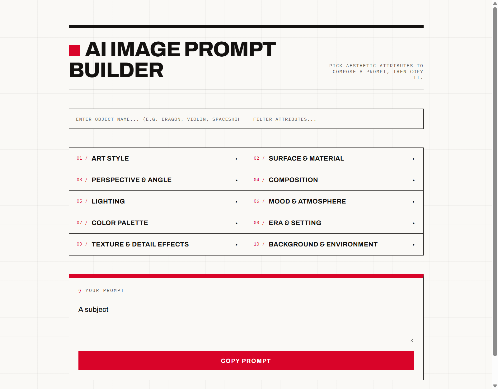
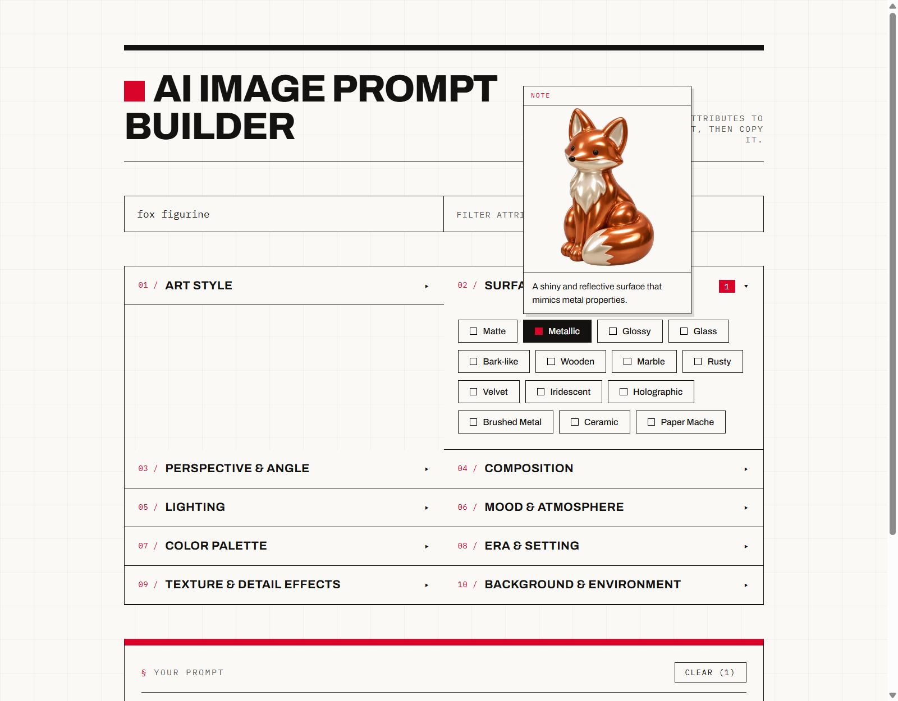

# Image Prompt Generator

A React + Vite tool for composing image prompts from 167 attributes in 10 categories.

The previous design was restored on November 14, 2026 at Marino's request. It uses the original accordion categories, checkbox chips, typography, black/red styling, and prompt panel. All generated images are retained.





[Phone layout](docs/screenshots/phone.png)

## Run

```powershell
npm install
npm run dev
```

For a loopback review preview with a fixed two-hour lifetime:

```powershell
npm run review
```

The server URL, owned PID, and expiration are recorded in `.local/preview-5173.json`. Reuse an existing instance. HMR and automatic polling do not extend its lifetime. To inspect and stop the recorded instance:

```powershell
$preview = Get-Content .local/preview-5173.json | ConvertFrom-Json
Get-CimInstance Win32_Process -Filter "ProcessId = $($preview.pid)" | Select-Object ProcessId,CommandLine
Stop-Process -Id $preview.pid
```

## Use

Enter a subject, expand categories, and toggle attributes. The filter searches attribute names. Hover an attribute to see its description and generated image. Copy the composed prompt or clear selections. The subject and selections are stored in browser local storage.

## Images

All 167 attributes retain their generated examples: 163 unique images and 489 WebP files, about 30.1 MB total. Five attributes share the default reference. The reference is a seated terracotta-orange and ivory matte clay fox in a three-quarter view under soft diffused studio light. Other properties stay fixed where the demonstrated attribute permits it. Styles, moods, composition, and settings sometimes require coupled changes; these are illustrative examples.

- `public/words.json` keeps all original categories, names, descriptions, and generated preview links.
- `public/images/` contains 240px, 480px, and up-to-1280px versions. The restored hover previews use the 480px files; the other sizes remain available.
- `docs/image-generation.json` records the baseline, prompts, original paths, revisions, and asset metadata.
- Generated originals remain at the paths recorded in the ledger. Runtime images are contained in this repository. Aspect ratios and alpha channels are preserved.

```powershell
py scripts/optimize-images.py
py scripts/audit-images.py --complete --review-dir "C:/Users/marin/agent-files/trash/project-reviews/image-prompt-generator/20261114"
```

Image processing requires Pillow and the retained machine-specific originals. Do not regenerate images merely to restore the interface.

## Active implementation and continuation

- `src/App.jsx` imports `src/components/PromptGenerator.jsx` and `src/styles.css`.
- `Category.jsx`, `Checkbox.jsx`, and `CopyButton.jsx` provide the original controls and hover previews.
- `index.html` restores the original Archivo and IBM Plex Mono font setup.
- The rejected redesign files (`PromptBuilder.jsx`, `builder.css`, `AttributeCard.jsx`, `ImageViewer.jsx`, and related helpers) remain in the checkout but are not imported by the active application. Do not re-enable that design without a new request.

Preserve the original design and all generated assets when continuing. Keep new image examples consistent with the saved baseline and use the master reference image. Disposable review captures belong under `C:/Users/marin/agent-files/trash/project-reviews/image-prompt-generator/`.

## Validation

```powershell
npm run lint
npm test
npm run build
```

The restore passed build, lint, and five catalog/helper/asset tests. The original desktop and phone layouts, filtering, selection, prompt output, and a loaded image hover preview were checked in the running app. SHA-256 verification confirmed that all 489 WebP files, the full catalog, and image provenance were unchanged by the restore. Review media is kept under the project-reviews path above. Changes remain local and uncommitted.
