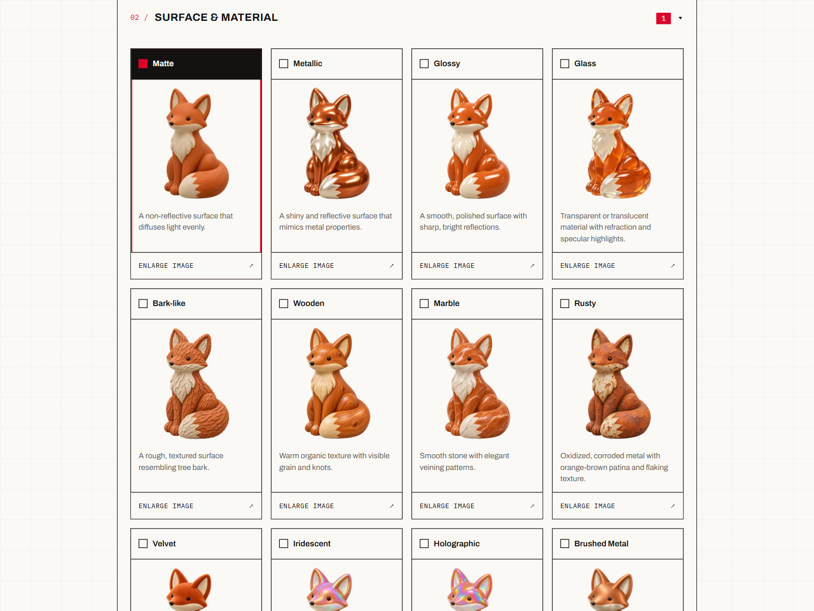
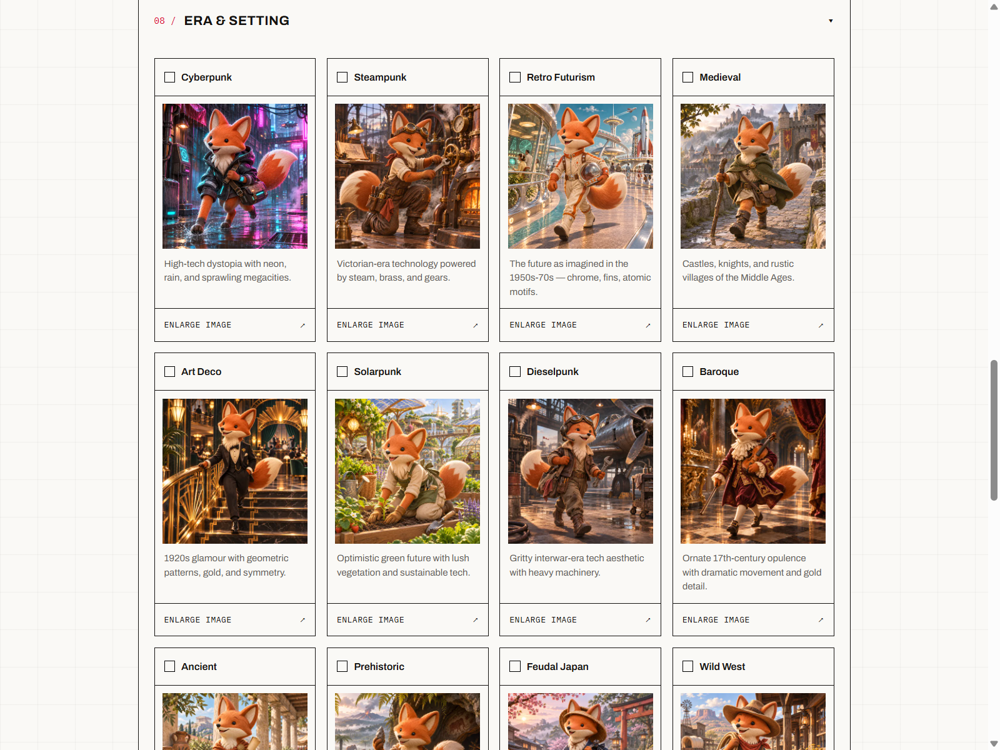

# Image Prompt Generator

A React + Vite tool for composing image prompts from 167 attributes in 10 categories.

The restored red-and-black accordion interface remains active. Choose **Text** for the original checkbox chips or **Images** to show each attribute name above its picture. In Images view, clicking a name or picture toggles that attribute. **Enlarge image** opens the large version separately.





[Text view](docs/screenshots/compose.png) · [Large material preview](docs/screenshots/material-preview.png) · [Phone image selection](docs/screenshots/phone.png) · [Phone preview](docs/screenshots/phone-image-preview.png)

## Start here for a new session

Read [AGENTS.md](AGENTS.md), then [the image-generation contract](docs/IMAGE-GENERATION.md). The contract captures the user's baseline, category exceptions, decisions, and deferred ideas. [The exact prompt ledger](docs/image-generation.json) records the current prompts, older prompts/sources, and asset metadata. The original [fox master](docs/reference/fox-master.png) is bundled here; generating another example does not require this chat or an external `.codex` file.

**Era & Setting is an explicit exception to the controlled figurine baseline.** Keep the recognizable fox character, but integrate its role, pose, clothing, equipment, action, light, and environment into the theme. No unchanged clay fox on a display pedestal. Other categories keep the common defaults unless the illustrated property requires a change.

Aqua Glass belongs in **Surface & Material**. Older saved selections move there automatically without losing other effects/materials. Pixel-art variants and the existing art-style images remain unchanged in this update; their possible overlap and dimensional appearance are documented for future review.

## Run

```powershell
npm install
npm run dev
```

For a loopback preview with a fixed two-hour lifetime:

```powershell
npm run review
```

The URL, owned PID, and expiration are recorded in `.local/preview-5173.json`. Reuse a running instance. HMR and automatic polling do not extend its lifetime. Inspect the recorded process before stopping it:

```powershell
$preview = Get-Content .local/preview-5173.json | ConvertFrom-Json
Get-CimInstance Win32_Process -Filter "ProcessId = $($preview.pid)" | Select-Object ProcessId,CommandLine
Stop-Process -Id $preview.pid
```

## Use

1. Enter a subject and expand a category, or filter attribute names.
2. Choose Text or Images. Switching views preserves selections and open categories.
3. In Images view, click the picture or its heading to select or deselect it. Use Enlarge image for the full-size preview. Escape closes that dialog and returns keyboard focus.
4. In Text view, hover or focus an attribute for its description and image.
5. Copy the composed prompt, or clear selections.

The subject, selections, and display preference are stored locally in the browser. Invalid saved entries are ignored. Multiple selections remain available for deliberate blends. This app does not generate images or send subjects/selections to a service.

## Image assets and generation

All 167 attributes have examples: 163 unique images and 652 WebP files, approximately 35.0 MB total. Five attributes share the default reference. The November 15 revision regenerated all 17 era/setting scenes as themed characters and gave Aqua Glass a transparent material example. Exactly those 18 examples changed (54 responsive files); all 435 unrelated existing WebP files were preserved. A 360px variant was also added for every example to reduce unnecessary bandwidth on higher-density small displays.

- `public/words.json` owns categories, names, descriptions, and preview links.
- `public/images/` holds 240px, 360px, 480px, and up-to-1280px versions, preserving aspect ratios and alpha.
- Inline browsing uses responsive 240/360/480px sources with layout-accurate size hints. The first four examples in an expanded category load eagerly; later examples load lazily. Large files load only on enlargement.
- `docs/image-generation.json` stores current and historical prompts/sources. The human-readable contract takes precedence over older prompts when a user changes a rule.
- The optimizer reuses complete existing variants without opening their machine-specific original PNGs. New or missing variants need the corresponding source output. Runtime files and the master reference are contained in this repository.

```powershell
py scripts/optimize-images.py
py scripts/audit-images.py --complete --review-dir "C:/Users/marin/agent-files/trash/project-reviews/image-prompt-generator/20261115"
```

Image processing uses Pillow. Use the installed image-generation skill and built-in tool for new examples; API-key fallback requires an explicit choice. Keep generated originals and record exact prompts before replacing runtime versions. Do not regenerate unrelated assets during UI work.

## Active implementation

- `src/App.jsx` imports `PromptGenerator.jsx` and `styles.css`.
- `Category.jsx` retains the accordions and switches between `Checkbox.jsx` and `InlineAttribute.jsx`.
- `ImagePreview.jsx` is the native-dialog full-image viewer in the original visual theme.
- `src/lib/catalog.js` contains saved-selection normalization/migration and shared image URL helpers. The active composer retains its original prompt templates.
- The rejected `PromptBuilder.jsx` / `builder.css` redesign remains inactive. Do not re-enable it without a new request.

## Validation and review

```powershell
npm run lint
npm test
npm run build
```

The November 15 work passed lint, seven tests, the production build, and the complete 167-attribute/alpha/decode audit for 652 files. A no-op optimizer run was tested with original PNG access disabled. All new era scenes were visually reviewed. Browser checks covered image clicking, keyboard selection, mode/open-category preservation, reload persistence, the old Aqua Glass migration, full-size loading, Escape/focus return, and 390px/320px phone layouts. Cold-context Chromium checks at five viewport/density combinations confirmed the expected 240/360/480px requests and zero large-image requests before enlargement. These were emulated viewports and pixel densities, not physical-phone measurements.

Disposable captures, contact sheets, and review bundles live under `C:/Users/marin/agent-files/trash/project-reviews/image-prompt-generator/`. Keep that evidence separate from source and share-safe README screenshots.
